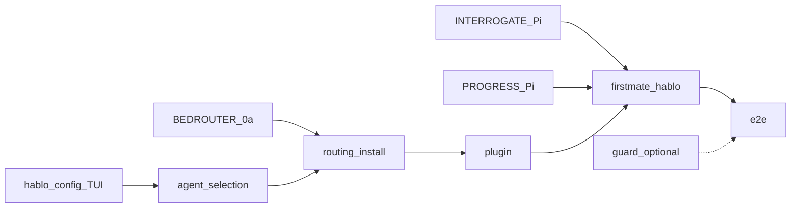

# Claude Code as a HABLO client

> **Status: docs synced; implementation not started.** Executive plan for TODO.md item 6.  
> Detail specs remain under [`later/CLAUDE-CODE*.md`](later/CLAUDE-CODE.md).

**Verdict: possible.** firstmate already has a `claude` harness. HABLO work is install/plugin/`hablo` surface plus bedrouter Messages `auto` (Phase 0a, shipped in `bedrouter@0.10.0`).

## Prerequisites (locked)

| Doc | Role | Status |
|---|---|---|
| `CONFIG-TUI-PLAN.md` (workspace backlog) | Claude reuses the **Agent** toggle; no second settings path | **Done** |
| `INTERROGATE-PLAN.md` (workspace backlog) | Plan mode / TDD interview on Pi first; Claude inherits the same product rule | **Done (Pi)** — Claude path must carry it |
| `PROGRESS-UPDATE-PLAN.md` (workspace backlog) | Commit + PR → Jira progress on Pi first; Claude adds the same duty | **Done (Pi)** — Claude path must carry it |
| `BEDROUTER-PHASE-0.md` (workspace backlog) | **0a required** (Anthropic-only `auto` on `/v1/messages`). **0b deferred.** 0c nice-to-have | **0a done** (`bedrouter@0.10.0` / `pi-bedrouter@0.10.0`); live Claude+SSO smoke still open |

Interrogate and Progress are **not** Claude-only features. They shipped on Pi so Claude MVP extends them rather than inventing a second product rule.

## Locked product decisions

- Route Claude Code through **bedrouter** (`ANTHROPIC_BASE_URL` → `/v1/messages`), **not** native `CLAUDE_CODE_USE_BEDROCK=1` (escape hatch only).
- First ship is **Anthropic-only** ladder on Messages; cross-vendor (0b) later.
- **Install:** prompt for default agent (`pi` / `claude` / `both`); `--agent` wins for scripts/CI.
- **Runtime:** `hablo-config` toggles Pi ↔ Claude anytime; **warn** if `claude` missing / not on `PATH`; preference still saves.
- **`hablo` launch:** if Claude selected but binary missing → **prompt to install or exit** (no silent Pi fallback).
- **`hablo-guard`:** **optional** for first Claude ship (Pi does not fully have it yet). Add later with Pi per HOOKS / CLAUDE-CODE-GUARD.
- **Interrogate:** when `interrogate.enabled`, a Claude captain nudges the same senior-lead interview / TDD under `~/tdds/…` before spawn; explicit skip allowed. Skill pin + overlay already install-owned; Claude needs skill/plugin access + captain prompt parity.
- **Progress:** every meaningful commit and PR open still update Jira (never Done). CLI (`hablo-jira progress` / `pr-opened`) is shared; Claude needs hook/policy parity with the Pi post-tool path (plugin hooks or equivalent).

## What ships

1. Claude Code CLI install/detect.
2. `~/.claude/settings.json` `env` → bedrouter; SessionStart starts daemon (never auto-stops it).
3. HABLO plugin: openwiki skill, agents/commands/workflows adapted from Pi assets; TDD/interrogate skill surface when enabled.
4. firstmate: `crew-harness=claude`, `claude-permission-mode=auto`, Claude dispatch file; `hablo` Claude branch + append-system-prompt (includes interrogate / ticket-progress standing text when those flags/policies are on).
5. Progress: Claude-side hooks (or documented equivalent) calling the same `hablo-jira` CLI after commit / `gh pr create`.
6. TUI Agent page + launch-time missing-binary UX (TUI already has the Agent page).

## Feasibility

| Area | Notes |
|---|---|
| firstmate Claude spawn/trust/stop | Already upstream |
| HABLO `--agent`, plugin, settings, `hablo` branch | Not built — specs in TODO/later |
| openwiki as skill | Not built — feasible |
| `/v1/messages` pinned Anthropic | Exists |
| `/v1/messages` **`auto`** | **Shipped (0a)** — confirm with live Claude+SSO smoke |
| Interrogate / TDD (Pi) | Shipped — Claude needs skill + prompt/policy wiring |
| Progress CLI + Pi hooks | Shipped — Claude needs commit/PR hook parity |
| Cache / count_tokens | Missing — 0c, not launch-critical |
| Guard | Optional follow-on |

## Phased work



| Phase | Work | Effort |
|---|---|---|
| (done) | TUI + Interrogate (Pi) + Progress (Pi) + Bedrouter **0a** | — |
| 1 | Install prompt, `--agent`, on-disk default marker, receipt | ~2–3 days |
| 2 | Claude install + settings env + SessionStart | ~1–2 days |
| 3 | Plugin (openwiki skill, agents, commands; TDD skill when interrogate on) | ~3–5 days |
| 4 | firstmate/`hablo` Claude path; missing-Claude prompt; captain prompt carries interrogate + progress duties | ~2–3 days |
| 4b | Claude progress hooks → `hablo-jira` (commit + PR) | ~1–2 days (can land with 3–4) |
| 5 | Guard shim | **Optional** — ~2–3 days once engine exists |
| 6 | E2E (see below) | ~2–3 days |

**MVP (no guard, Anthropic-only auto):** ~2–3 weeks of Claude-specific work after the Pi prerequisites above.

## E2E (phase 6) — must cover

- Claude voyage: captain + crewmate on bedrouter `auto` (`/v1/messages`).
- TUI Agent flip Pi ↔ Claude; missing-`claude` binary → install-or-exit (no silent Pi).
- **When `interrogate.enabled`:** interview nudge (or explicit skip) → TDD under `~/tdds/<KEY>-…/` before implementers spawn; optional Jira spec comment with path.
- **Progress:** after a commit on the ticket branch, Jira gets a progress comment (SHA dedupe); after `gh pr create`, PR URL comment + `in-review` (or reap backfill if the hook soft-failed).
- Soft-fail: Jira/network miss does not block git/gh; miss is visible.

## Config sketch

```json
"agents": {
  "default": null,
  "$commentDefault": "null = prompt at install; --agent wins. Runtime default = ~/.hablo marker + crew-harness that hablo-config edits.",
  "pi": { "enabled": true },
  "claude": { "enabled": true }
}
```

Interrogate and progress keep their existing `hablo.json` keys; Claude does not get a parallel flag set.

## Implementation todos

- [x] Bedrouter **0a** (`BEDROUTER-PHASE-0.md` (workspace backlog)); pin in HABLO (`pi-bedrouter@0.10.0`)
- [x] Ship `CONFIG-TUI-PLAN.md` (workspace backlog) with Agent toggle (warn if Claude missing)
- [x] Interrogate on Pi (`INTERROGATE-PLAN.md` (workspace backlog))
- [x] Progress on Pi (`PROGRESS-UPDATE-PLAN.md` (workspace backlog))
- [ ] Live Claude+SSO streaming `tool_use` smoke against bedrouter (`npm run smoke:claude` / `BEDROUTER_SMOKE_TOOLS=1`)
- [x] Phase 1: install prompt + `--agent` + marker + receipt
- [x] Phase 2: Claude + bedrouter settings + SessionStart
- [x] Phase 3: HABLO Claude plugin (incl. TDD/interrogate skill surface)
- [x] Phase 4: firstmate/`hablo` + missing-Claude install-or-exit prompt
- [x] Phase 4b: Claude commit/PR → `hablo-jira` progress parity (plugin hooks in Phase 3)
- [x] Phase 6: E2E fixtures (`test/e2e-claude.test.mjs`); live SSO smoke script (`bin/hablo-e2e-claude-smoke.sh`)
- [ ] Phase 5 (optional later): guard with Pi

## Non-goals

- Replacing Pi
- 1:1 port of every Pi package
- Native Bedrock as default path
- Bedrouter stack editor in hablo-config
- Requiring 0b or guard for first ship
- Re-implementing Interrogate or Progress as Claude-only products

## Related plans

- `BEDROUTER-PHASE-0.md` (workspace backlog) · `CONFIG-TUI-PLAN.md` (workspace backlog) · `INTERROGATE-PLAN.md` (workspace backlog) · `PROGRESS-UPDATE-PLAN.md` (workspace backlog) · [`GOVERNANCE-PLAN.md`](GOVERNANCE-PLAN.md)

## Source specs

- [`CLAUDE-CODE.md`](later/CLAUDE-CODE.md) · [ROUTING](later/CLAUDE-CODE-ROUTING.md) · [PLUGIN](later/CLAUDE-CODE-PLUGIN.md) · [FIRSTMATE](later/CLAUDE-CODE-FIRSTMATE.md) · [AGENT-SELECTION](later/CLAUDE-CODE-AGENT-SELECTION.md) · [GUARD](later/CLAUDE-CODE-GUARD.md) (optional track)
