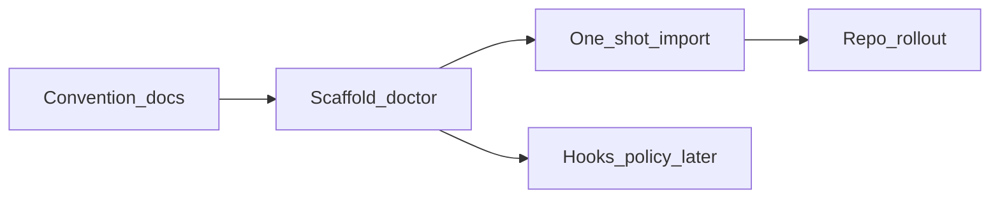

# Project agent governance (Pi + Claude + Cursor)

> **Status: draft plan** (not implemented).  
> **Goal:** one editable rules body per repo; thin adapters for each harness; no ongoing sync into a fourth dialect.

Mixed teams will use Pi, Claude Code, and Cursor against the same repositories. Without a convention, rules and hooks fork into `AGENTS.md`, `CLAUDE.md`, `.cursor/rules/`, and eventually a HABLO-specific file — four places to drift.

## Locked decisions

| Decision | Choice |
|---|---|
| Canonical project rules | **`AGENTS.md`** at the repo root (edit this) |
| Claude adapter | **`CLAUDE.md`** stub that only includes the canonical file (`@AGENTS.md`) — already used in bedrouter / pi-openwiki-adapter |
| Cursor adapter | Thin rule under `.cursor/rules/` that points at `AGENTS.md` (include or “read and follow”); Cursor-only globs stay as separate thin files |
| Symlinks for committed rules | **No** as the default (tools rewrite paths into real files; Windows pain). Prefer include stubs |
| New `HABLO.md` as ongoing source of truth | **No.** Fleet policy stays in installer / firstmate / extensions; project knowledge stays in `AGENTS.md` |
| `hablo import` | **One-shot migration** into `AGENTS.md` + write/refresh stubs; not a continuous sync engine |
| Hooks | Share **policy** (guard config / rule ids); keep **per-harness shims**. Do not unify hook script formats across Pi / Claude / Cursor |

Dream already prefers machine-enforced targets over prose (`hablo.json` guard, CI, then project `AGENTS.md` / `CLAUDE.md`). This plan keeps that order.

## Target layout (per project)

```text
AGENTS.md                 ← humans and agents edit this
CLAUDE.md                 ← stub: @AGENTS.md
.cursor/rules/
  agents-md.mdc           ← stub: follow AGENTS.md (optional alwaysApply)
  …                       ← Cursor-only scoped rules only when needed
```

Stub examples:

```markdown
<!-- CLAUDE.md — edit AGENTS.md, not this file. -->
@AGENTS.md
```

```markdown
---
description: Project agent rules (canonical AGENTS.md)
alwaysApply: true
---

Follow the instructions in [`AGENTS.md`](../AGENTS.md) at the repository root.
Do not duplicate those rules here.
```

Exact Cursor frontmatter / include syntax may need a one-line smoke check against the Cursor version the team runs; if `@` includes work for `.mdc`, prefer that over restating the path in prose.

## Phased work



### Phase G0 — Convention + docs (~0.5–1 day)

- Write the layout above into HABLO-installer README (short “Project rules” section) and point Dream / Claude plans at this file.
- Document: edit `AGENTS.md` only; never paste the same body into `CLAUDE.md` or Cursor rules.
- Note fleet vs project: captain policies and tone are HABLO-owned; repo rules are for local knowledge.

**Done when:** a developer can open one doc and know what to create in a greenfield repo.

### Phase G1 — `hablo rules` scaffold / doctor (~2–3 days)

Small CLI surface (name bikeshed OK: `hablo rules init | doctor`):

| Command | Behavior |
|---|---|
| `hablo rules init` | If missing: create `AGENTS.md` (minimal template), `CLAUDE.md` stub, optional Cursor stub. **Never overwrite** an existing non-stub body; refuse or `--force` with backup |
| `hablo rules doctor` | Report: canonical present? Claude stub points at it? Cursor stub present/stale? Warn if `CLAUDE.md` or a Cursor rule looks like a full duplicate of `AGENTS.md` |

Install receipt / uninstall: only touch files this command created (same safety posture as other HABLO writers).

**Done when:** `init` + `doctor` tested; safe on repos that already have a fat `CLAUDE.md`.

### Phase G2 — One-shot `hablo rules import` (~2–3 days)

Migrate *into* the canonical file; leave adapters as stubs.

1. Collect candidates: existing `AGENTS.md`, `CLAUDE.md` (if not already a stub), `.cursor/rules/*`, optional `.cursorrules`.
2. Propose a merged `AGENTS.md` (deterministic concat with clear section headers + provenance comments; optional later: LLM assist behind a flag).
3. Write stubs for Claude / Cursor; move displaced full files to `*.pre-hablo-rules.bak` (or git-friendly rename) — **do not delete**.
4. Print a short diff summary; require confirmation unless `--yes`.

**Done when:** a fixture repo with duplicated Claude + Cursor rules ends as one `AGENTS.md` + stubs; originals recoverable from backups.

### Phase G3 — Rollout on HABLO-owned repos (~1 day + PRs)

Apply the convention to bedrouter, pi-bedrouter, pi-openwiki-adapter, HABLO-installer (and any other in-tree projects): stubs where missing; doctor clean.

**Done when:** those repos `hablo rules doctor` clean (or documented exceptions).

### Phase G4 — Hooks / guard alignment (later; not a G1 gate)

Depends on [`HOOKS.md`](HOOKS.md) and Claude guard work:

- One policy surface (e.g. `hablo.json` / `.hablo/guard.json`).
- Thin Pi extension + Claude `PreToolUse` (and later Cursor if needed) call the same engine.
- Project *prose* rules stay in `AGENTS.md`; enforceable denies stay in guard config.

**Done when:** adding a protected path is one config change, not three hook scripts.

## Acceptance

- [ ] Convention documented (G0)
- [ ] `hablo rules init` / `doctor` (G1)
- [ ] `hablo rules import` one-shot migration with backups (G2)
- [ ] HABLO-owned repos on the layout (G3)
- [ ] Guard/hooks share policy, not duplicated scripts (G4, later)

## Non-goals

- Continuous bi-directional sync between Cursor ↔ Claude ↔ Pi files
- Making `HABLO.md` the project rules home
- Symlink farms as the supported Windows path
- Replacing Dream’s proposal targets or firstmate `AGENTS.md` injection
- Unifying Pi / Claude / Cursor hook *APIs* into one script format

## Effort (rough)

| Phase | Effort |
|---|---|
| G0 | ~0.5–1 day |
| G1 | ~2–3 days |
| G2 | ~2–3 days |
| G3 | ~1 day + review |
| G4 | follows guard engine; separate estimate |

**Useful slice without Claude MVP:** G0–G1 anytime. G2 when teams already have duplicated rules. G4 after hook engine exists.

## Related

- Workspace backlog `CLAUDE-PLAN.md` — Claude as HABLO client (consumes project `AGENTS.md` / stub `CLAUDE.md`)
- [`DREAM.md`](DREAM.md) — proposals prefer enforceables, then project `AGENTS.md` / `CLAUDE.md`
- [`HOOKS.md`](HOOKS.md) · [`later/CLAUDE-CODE-GUARD.md`](later/CLAUDE-CODE-GUARD.md)
- Existing pattern: bedrouter `CLAUDE.md` → `@AGENTS.md`
