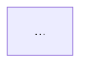

# Technical Design Docs

A TDD exists so an **approver can decide whether this is the right approach** —
not so an implementer can copy-paste from it. Everything in this skill follows
from that. The most common way these docs fail is not being too vague; it's
drowning the decision in implementation detail until nobody can find it.

## Workflow

1. **Build context from the code first.** Read the actual system before asking
   anything. Find how the thing works today: the entry point, the data model,
   the config path, the existing flags or hooks that a new one would ride on.
   Most design questions are already answered in the repo, and an interview that
   asks what the code could have told you burns the user's goodwill.
2. **Interview on what the code can't answer.** See "Interviewing" below.
3. **Write the doc** using `assets/tdd-template.md`, at the altitude described
   in "Altitude", to the location in "Where the doc goes".
4. **Add diagrams** per the triggers in "Diagrams".
5. **Render the diagrams** to `images/` with `scripts/render_diagrams.py`.
6. **Self-check** against the "Review checklist" before handing it over.
7. **Export to docx once the driver has reviewed it** — `make docx` — so it can
   be shared on the team's SharePoint. See "Sharing on SharePoint".

Summarize the two or three decisions that most need the user's attention in your
reply. Don't paste the whole doc into chat — it's a file, and the user will read
it there.

## Where the doc goes

For any project under `~/Projects`, TDDs live outside the repo in `~/tdds`, one
folder per doc:

```
~/tdds/
├── Makefile           render/scaffold helpers — `make` alone prints help
├── .gitignore         rendered images are generated, not committed
└── <TICKET>-<slug>/
    ├── README.md      the doc
    ├── *.drawio       hand-arranged diagrams, if any — committed source
    ├── *.png          screenshots and mockups referenced by the doc
    ├── <TICKET>-<slug>.docx   generated for SharePoint, once reviewed
    └── images/        rendered diagrams, SVG + PNG per diagram
```

Keep committed images out of `images/` — that directory is gitignored as build
output, so anything dropped in it is liable to be deleted and never rebuilt.

`~/tdds` is a git repo with a Makefile driving the work. Prefer it over calling
the render script directly:

| Command | Does |
|---|---|
| `make` | print help (default goal) |
| `make new NAME=TICKET-slug` | scaffold a folder and a `README.md` from the template |
| `make all` | render every TDD whose doc changed since its last render |
| `make <TICKET>-slug` | render just that one |
| `make list` | show each TDD's render state (rendered / stale / not rendered) |
| `make check` | verify the render toolchain before you need it |
| `make docx` | build the shareable `.docx` for every TDD (renders diagrams first) |

Images and generated `.docx` files are gitignored — both are built from the
markdown, so commit the doc and let `make` rebuild them.

## Sharing on SharePoint

Once the driver has reviewed the doc, `make docx` converts it to a Word file
built on the team's template, ready to upload. The markdown stays the source of
truth; never hand-edit the generated `.docx`, because the next `make docx`
overwrites it.

The conversion is deliberately narrow — it supports the markdown the template
actually uses, and nothing else. Fenced mermaid/plantuml blocks are replaced by
the PNGs `render_diagrams.py` already produced, so diagrams must be rendered
first; `make docx` handles that ordering. `references/docx.md` has the full
element mapping and what to do when the team updates the template.

`README.md` rather than a named file — the folder name already carries the
identity, and README renders as the folder index in any viewer. Slug the title
in kebab-case; drop the ticket prefix if there isn't one.

Keeping these out of the repo is deliberate: a design doc's review lifecycle
doesn't match the code's, and repo `docs/` directories are often published
artifacts (Hugo sites, API references) where an internal DACI doc doesn't belong.
Check before assuming a repo `docs/` folder is a private place to write.

For projects outside `~/Projects`, follow the repo's own convention if it has one
(a `docs/design/` or `rfcs/` directory with existing examples), and otherwise ask.

## Interviewing

Ask only questions where different answers produce **materially different
designs**. Good candidates: what the default should be, whether backward
compatibility matters, the granularity of a new control, whether a surface
(IaC, CLI, docs) is in scope, who owns a boundary.

Use `AskUserQuestion` with 2–4 concrete options. Put your recommendation first
and label it `(Recommended)`. Describe each option by its *consequence*, not its
mechanism — "existing configs keep working, new ones opt in" beats "adds a
nullable column". Batch questions; two rounds of four beats eight rounds of one.

Don't ask about: naming you can infer from the codebase's conventions, whether
to write tests, which files to touch, or anything you're about to go read.

For the DACI block, don't invent people. Ask who the driver and approver are, or
leave `<name>` placeholders and say you've left them for the user to fill.

## Altitude

This is the part that matters most. The template's sections are narrow on
purpose.

**Keep** — things that change an approver's decision:
- What behavior changes, for whom, and under what conditions.
- Defaults, and what happens to data and configs that already exist.
- The external surfaces being added or changed — endpoints, payload fields,
  CLI flags, IaC attributes, config keys — and how they behave.
- Constraints that shape the design ("the generated client can't express an
  absent boolean, so absence has to be detected separately").
- Trade-offs, risks, and what the approach gives up.

**Cut** — things that only matter once someone is typing:
- Code bodies. The API section holds signatures and types, not implementations.
- Framework and language mechanics. *That* a field must distinguish unset from
  false is design. *Why* the ORM forces a pointer to achieve it is not.
- Line numbers, exhaustive call-site lists, per-file edit instructions.
- Enumerated test cases. "Covered by unit tests at the config layer and an
  end-to-end check of the two-input case" is enough; a bulleted list of every
  assertion is not.
- PR sequencing and estimates, unless the user asked for them.

**The test:** for each detail, ask *would an approver read this and vote
differently?* If not, cut it. When a real implementation gotcha genuinely
constrains the design, compress it to one sentence of consequence — usually in
Disadvantages — rather than a paragraph of mechanism.

A TDD that has been cut well reads as slightly *under*-specified to the person
who did the research. That's the correct feeling. The research shows up as
confidence in the prose, not as volume.

## Diagrams

Read `references/diagrams.md` for syntax, worked examples, and salt element
tables. The triggers:

| If the change… | Use |
|---|---|
| adds/removes components, or moves data ownership or control flow between them | `mermaid` flowchart, proposed state with changed nodes marked |
| the same, but auto-layout keeps producing a tangle, or the arrangement itself carries meaning | a `.drawio` file beside the doc — hand-placed, and re-arrangeable by whoever reviews it |
| alters a pipeline, message path, or API request flow — especially adding a conditional branch | `mermaid` sequenceDiagram, with `alt`/`opt` for the new branch |
| adds, moves, or gates any UI control, screen, dialog, or state | PlantUML `salt` wireframe, one block per screen |

More than one trigger can fire; a feature spanning API, pipeline, and UI gets
all three. None firing is a legitimate outcome — a change confined to one
component with no flow or UI impact doesn't need a picture, and a decorative
diagram costs the reader time.

Diagrams belong in **Proposed Implementation**, interleaved with the prose that
explains them, not collected in an appendix.

### Rendering to images

Keep the fenced source in the markdown as the single source of truth, and render
alongside it into `images/`. The doc stays diffable and editable; the SVGs exist
for destinations that can't render fenced blocks — PlantUML salt in particular
does not render on GitHub or in most PR descriptions.

Label each diagram with an HTML comment on the line before its fence so the
generated filenames are meaningful. It's invisible in rendered markdown:

```
<!-- diagram: archive-path -->


Then render — from `~/tdds`, `make <TICKET>-slug`, or directly:

```bash
python3 ~/.claude/skills/technical-design-doc/scripts/render_diagrams.py \
    ~/tdds/<TICKET>-<slug>/README.md
```

The script extracts every `mermaid` and `plantuml` block in document order and
writes `images/01-<label>.svg` plus `.png`, `02-…`, and so on. Both formats by
default: SVG scales and diffs, PNG is what actually pastes into Jira and
Confluence. `--format svg` or `--format png` if you only need one.

**Hand-arranged diagrams** are the second source. Drop a `.drawio` file in the TDD
folder and `make` renders it into the same `images/`, named after the file rather
than numbered, so it does not disturb the fenced diagrams' numbering:

```bash
node ~/.claude/skills/technical-design-doc/scripts/render_drawio.mjs \
    ~/tdds/<TICKET>-<slug>/architecture.drawio
```

Reference the result from the markdown as an ordinary image —
`` — which the docx build embeds. The
`.drawio` is committed and the renders are not, the same split as everywhere else.
Reach for this when auto-layout will not settle: mermaid re-derives the arrangement
on every render, so a diagram whose layout is load-bearing fights it, and nobody
reviewing the doc can nudge a box. Stick to base mxGraph shapes — rectangles,
`shape=cylinder`, ellipses, text, orthogonal edges. draw.io's own stencils look
right in draw.io and fall back to plain rectangles in the render.

It exits non-zero and names the missing toolchain rather than silently producing
nothing, so a clean run is real evidence the diagram syntax parses — which is the
other reason to render. A diagram that has never been through a renderer may well
not be valid, and reviewing the PNGs catches layout problems that valid syntax
still produces.

Toolchain, both optional and independent — render what you can and report what
you couldn't:
- **mermaid**: `mmdc`, or Node so the script can reach it via `npx`. Needs a
  working headless Chrome (`npx puppeteer browsers install chrome`, plus system
  libraries on slim Linux images — the script prints the apt line if they're
  missing).
- **plantuml**: the `plantuml` command, or `PLANTUML_JAR` set with `java`
  available.
- **drawio**: `mxgraph` and `puppeteer-core` in the docs repo (`npm install`),
  plus a headless Chrome. No draw.io install and no network: the file is decoded
  by mxGraph, the library draw.io is built on, inside Chrome.

If a renderer is unavailable, say so plainly and give the install command. Do not
substitute a hosted renderer (kroki.io, mermaid.ink, plantuml.com) — that uploads
the design doc's contents to a third party. Ask first if it's the only option.

## Template

Copy `assets/tdd-template.md` and fill it in. Notes on the header:

- **Status** is a progression — keep the whole line and mark where the doc is
  (bold the current stage). New docs are `Draft`.
- **Last Updated** is `YYYY-MM-DD`. Update it on every edit.
- The DACI table's review markers are meaningful state: 👁‍🗨 unreviewed,
  ✅ approved, 🔶 change requested. Everyone starts at 👁‍🗨.

Don't add sections the template doesn't have. Risks go under **Disadvantages** —
that's what makes that section load-bearing rather than a formality. If the work
genuinely needs a section the template lacks (a migration runbook, a rollout
plan), say so and ask, rather than quietly extending the format.

**Advantages / Disadvantages** are a comparison against the status quo or the
alternatives you considered — not a list of the feature's benefits. If
Disadvantages is empty or hedged, the doc isn't finished; every real design
gives something up. Naming it is what earns an approver's trust.

## Review checklist

Use this to audit a doc — yours before handing it over, or someone else's when
asked to review. Each line is a concrete pass/fail.

**Location and assets**
- [ ] Lives at `~/tdds/<TICKET>-<slug>/README.md` (for `~/Projects` repos).
- [ ] Every diagram has a `<!-- diagram: name -->` label.
- [ ] `images/` holds a rendering of every diagram, or the gap is reported with
      the reason; the render script exited zero.
- [ ] The rendered output was actually looked at, not just confirmed to exist.

**Header**
- [ ] Title, Status (one stage marked), Last Updated (`YYYY-MM-DD`), Team present.
- [ ] DACI table filled or explicitly placeholdered; review markers present.

**Feature / Problem**
- [ ] States the problem and who feels it, before any solution.
- [ ] Explains today's behavior well enough to judge the proposal.
- [ ] Doesn't read as a code tour of the current implementation.

**Proposed Implementation**
- [ ] A reader can restate the approach in two sentences after reading it.
- [ ] Defaults and backward-compatibility behavior are stated explicitly.
- [ ] Existing data and configs are accounted for.
- [ ] Every fired diagram trigger has a diagram; no decorative diagrams.
- [ ] Diagrams mark what's new or changed.

**API**
- [ ] Describes the external contract — endpoints, payload fields, CLI flags,
      IaC attributes, config keys, emitted events — not internal modules.
- [ ] Compatibility is explicit: new vs. changed vs. removed, and what happens
      to callers that omit a new field or haven't upgraded.
- [ ] No function bodies, no line numbers, no per-file edit lists.

**Advantages / Disadvantages**
- [ ] Framed against the status quo or a named alternative.
- [ ] Disadvantages is specific and non-empty.

**Altitude (the common failure)**
- [ ] No passage explains a language or framework mechanic for its own sake.
- [ ] No enumerated test-case lists, PR splits, or estimates unless requested.
- [ ] Cutting any remaining paragraph would leave the approver less able to
      decide — if not, cut it.

When reviewing someone else's doc, report findings grouped by section, lead with
the ones that would change the decision, and distinguish "this is wrong" from
"this is more detail than the format wants."
