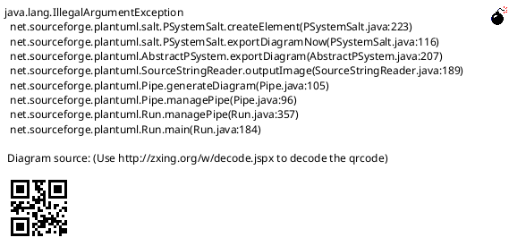

# <Title>

**Status:** Draft → Reviewable → Approved → Obsolete  |  Abandoned
**Last Updated:** YYYY-MM-DD
**Component:** <component>

| Role | People |
|---|---|
| **Driver** | <name> |
| **Approver** | 👁️ <name> |
| **Consulted** | 👁️ <name><br>👁️ <name> |
| **Informed** | 👁️ Product informed about new feature roadmap<br>👁️ Engineering informed about the technical roadmap |

**Key:** 👁️ = UNREVIEWED · ✅ = APPROVED · 🔶 = CHANGE REQUESTED

---

## Feature / Problem

<What we are trying to accomplish. The user-visible or operational problem, who
feels it, and why the current behavior is inadequate. Include enough of how
things work today that a reader can judge the proposal — but describe today's
system as behavior, not as a code tour.>

<Acceptance criteria, if the ticket has them.>

## Proposed Implementation

<How the solution works. Lead with the shape of the change in prose, then the
diagram(s). One or two paragraphs plus a diagram usually beats a long list.>

```mermaid
<architecture diagram — if components, data flow, or ownership change>
```

```mermaid
sequenceDiagram
<request/pipeline flow — if a call sequence or message path changes>
```



<Behavioral decisions a reviewer needs to weigh: defaults, backward
compatibility, migration, what happens to existing data.>

## API

<The external contract this change adds or alters — what someone outside the
codebase can call, send, or configure. Endpoints and payload fields, CLI
commands and flags, IaC attributes, config keys, emitted events and their
schemas, published client libraries.

Internal module layout, function signatures, and file organization are
implementation details; leave them out. The question this section answers is
"what does an integrator have to know?", not "what will the author touch?">

| Surface | Change |
|---|---|
| `POST /v1/thing/{id}` | new optional `field` (boolean, default `true`) |

<State compatibility explicitly: which surfaces are new, changed, or removed;
what happens to callers that omit a new field or have not upgraded; and whether
any existing response or event shape changes. If a surface a reader might expect
to change does not, say so — "no change to emitted events" is useful.>

<If the change is entirely internal and alters no external contract, say that in
one line rather than inventing entries.>

## Advantages

- <Why this approach over the alternatives / the status quo.>

## Disadvantages

- <Costs, risks, and what this approach gives up. Be honest — this section is
  what makes the doc trustworthy.>
