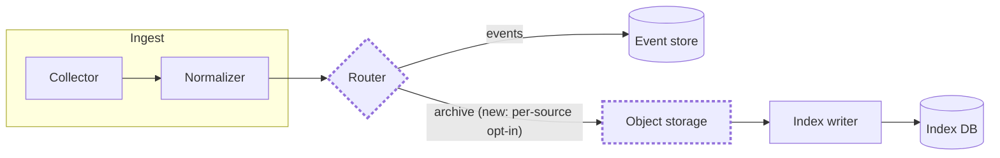
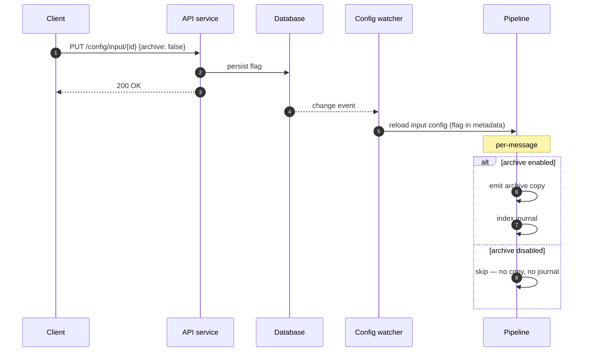
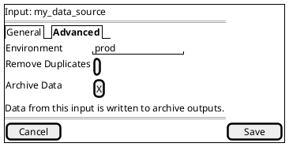

# Diagram patterns for TDDs

Three diagram types, each triggered by a specific kind of change. Read the
section that matches; skip the rest.

A diagram earns its place by answering a question faster than prose can. If the
change touches one component and one code path, prose is better — skip the
diagram. If a reviewer would otherwise have to hold four moving parts in their
head, draw it.

Keep diagrams under ~15 nodes. If it needs more, the diagram is doing the job of
two diagrams, or the design is doing the job of two designs.

---

## 1. Architecture changes → `mermaid` flowchart

Use when components are added, removed, merged, or when data ownership or
control flow between services moves.

Show the **proposed** state, and mark what is new or changed so the reviewer's
eye lands there. Two conventions, pick one and stay consistent:

**Highlight-in-place** (preferred — one diagram, less to read):

**Before/after** — only when the topology genuinely changes shape and a single
annotated diagram would be confusing. Two `flowchart` blocks under `**Today**`
and `**Proposed**` headings.

Notes that keep these readable:
- Use `subgraph` for service or deployment boundaries — it's usually the thing
  reviewers actually care about.
- Label edges with what flows, not with the function name that moves it.
- `[(Cylinder)]` for datastores, `{Diamond}` for branching, `[Rect]` for
  components. Consistency matters more than the specific choice.

---

## 2. Pipeline flows and API request flows → `mermaid` sequenceDiagram

Use when the **order** of operations changes, when a step is added or skipped
conditionally, or when a request's path through services changes.

This is the workhorse diagram for "we're adding a branch to an existing flow."

Notes:
- `alt`/`else` is how you show a conditional branch; `opt` for a step that may
  be skipped entirely. These blocks are usually the point of the diagram — the
  new decision is what the reviewer is being asked to approve.
- `Note over X` to mark a scope shift (per-request vs. per-message vs. batch).
- `autonumber` helps reviewers reference steps in comments.
- Include the failure or degraded path if it's part of the design decision.
  Leave it out if it's unchanged.

---

## 3. UI changes → PlantUML `salt` wireframes

Use when the change adds, moves, or gates a control, or introduces a new screen,
dialog, or state.

Salt is deliberately low-fidelity — that's the point. It shows placement and
labeling without inviting a debate about visual design.

Common salt elements:

| Element | Syntax |
|---|---|
| Checkbox | `[]` unchecked, `[X]` checked |
| Radio | `()` unselected, `(X)` selected |
| Text field | `"value here"` |
| Button | `[ Label ]` |
| Dropdown | `^Option 1^` |
| Tabs | `{/ Tab A \| <b>Tab B }` (bold = active) |
| Tree | `{T` then rows with `+` nesting |
| Table | `{#` then `\|`-separated rows |
| Separator | `==` horizontal, `--` dashed, `.` dotted |
| Grouping box | `{+ ... }` with border, `{ ... }` without |

Two syntax traps worth remembering: a checkbox is `[]` with **no** inner space —
`[ ]` is parsed as a button with a blank label. And `|` is the column separator,
so a row containing literal pipe-like text needs rewording.

For a **new state or dialog**, draw it as its own salt block with a heading
above it (`**Confirm dialog, shown when toggling Archive Data off:**`). For a
**list or table gaining a column or badge**, use the `{#` table form.

If several screens change, one salt block per screen, each under its own bolded
caption. Don't try to draw a flow between them — that's what a sequence diagram
is for.

---

## 4. Hand-arranged architecture → `.drawio`

Mermaid re-derives the layout on every render. That is usually a feature — the
diagram stays honest as you edit it — and occasionally the whole problem:

- The arrangement itself carries meaning. "Left to right, UI first, the datastores
  behind the service that fronts them, the writer above the table it writes to" is
  a claim about the system, and auto-layout will not honour it.
- Auto-layout produces a tangle. Past roughly a dozen nodes with cross-links,
  mermaid starts routing edges through boxes and stacking labels on lines.
- A reviewer wants to move something. Nobody nudges a mermaid box; they file a
  comment and wait for you.

When one of those bites, put a `.drawio` beside the doc instead. `make` renders it
into `images/` and the markdown references the PNG like any other image. The file
is committed, the renders are not.

Conventions that keep these editable rather than merely rendered:

| Concern | Do this |
|---|---|
| Shapes | Base mxGraph only: rectangles, `shape=cylinder` for datastores, ellipses, text, `edgeStyle=orthogonalEdgeStyle` edges. draw.io's own stencils (`cylinder3`, `mxgraph.*`) look right in draw.io and render as plain rectangles. |
| Grouping | A dashed container per deployment boundary, `container=1` so its children move with it. Left-align the title (`align=left;spacingLeft=10`) — a centred one collides with edges entering the top. |
| What changed | The same green/amber convention as the mermaid flowcharts, plus a small legend group in the corner, since a rendered PNG has no prose beside it in Jira. |
| Ports | For a component that writes or listens through a specific interface, a small filled rectangle as a child cell with `relative="1"` geometry on the parent's edge, and start the edge from the port rather than the box. It stays attached when the parent moves. |
| Labels on datastores | `verticalLabelPosition=bottom;verticalAlign=top` — a cylinder's top ellipse otherwise sits through the first line of its label. |
| Compression | Leave it off (File > Properties > Compressed). The renderer inflates a compressed page but the file stops being diffable. |

Everything else is ordinary draw.io. Open it, move things, save, re-run `make`.

## Rendering caveat

Mermaid renders natively in most Markdown viewers, GitHub, and Confluence with a
plugin. PlantUML salt usually does **not** render in plain GitHub Markdown. If
the doc's destination can't render `plantuml` fenced blocks, ask where the doc
will live and either:
- render the salt to a PNG/SVG and embed the image alongside the source block, or
- keep the fenced source (still readable as text) and note the render link.

Don't silently drop the wireframe because of a rendering limitation — ask.
